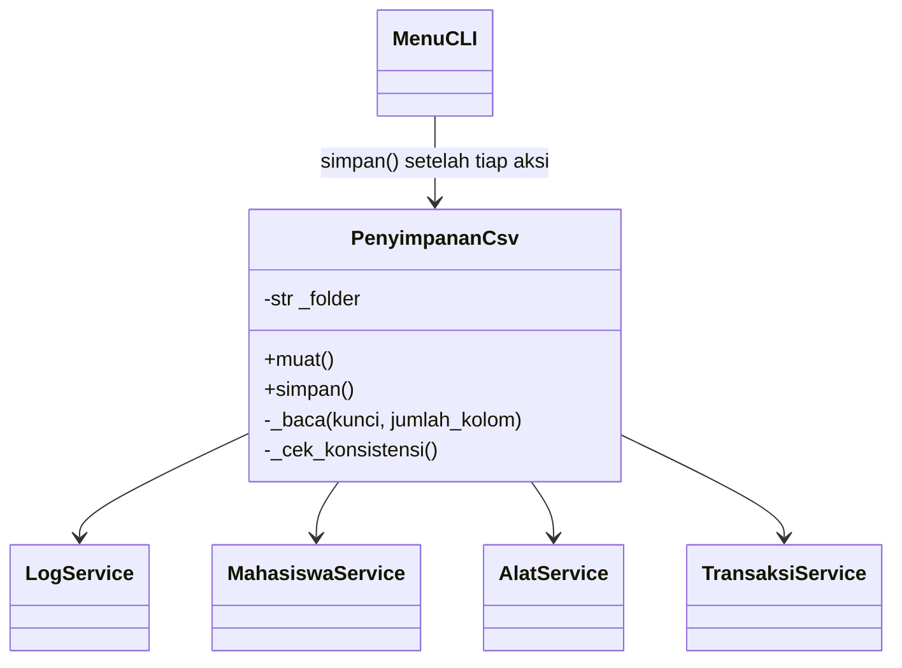

# Penyimpanan Permanen ke File CSV (Proyek 2)

Data disimpan ke file `.csv` di folder `data/` (dibuat otomatis di sebelah `main.py`) dan dibaca kembali
saat program dibuka. Tidak ada database. Memakai modul bawaan Python `csv`, `os`, `io`, `datetime`.

## Alur kerja
```
Program dibuka  -> PenyimpananCsv.muat()   : baca semua file .csv -> isi service (mahasiswa, alat, transaksi, log)
Setiap aksi menu berhasil -> PenyimpananCsv.simpan() : tulis HANYA file yang isinya berubah
Menu 0 (keluar) -> simpan sekali lagi
```

## Daftar file
| File | Kolom (baris pertama = judul kolom) |
|---|---|
| `data/mahasiswa.csv` | `nim;nama;no_hp` |
| `data/alat.csv` | `kode;nama;kategori;kondisi;status` |
| `data/kategori.csv` | `kategori` |
| `data/transaksi.csv` | `id;nim;tanggal_pinjam;batas_kembali;status` |
| `data/detail_transaksi.csv` | `id_transaksi;kode_alat;tanggal_kembali;kondisi_kembali;terlambat` |
| `data/log.csv` | `waktu;pesan` |

Contoh isi nyata ada di [`contoh_data/`](contoh_data/).

## Aturan format
- **Pemisah `;`** (titik koma) agar langsung terbuka rapi di Excel berbahasa Indonesia. Ubah konstanta `PEMISAH`
  di `services/penyimpanan_csv_service.py` menjadi `","` jika ingin koma. Saat **membaca**, `;` dan `,` dikenali otomatis.
- Baris pertama berisi nama kolom (dilewati saat membaca; bila tidak ada, baris itu dianggap data).
- Tanggal berformat `YYYY-MM-DD`. Nilai kosong (belum dikembalikan) ditulis `-`. Kolom `terlambat`: `1` atau `0`.
- Karakter khusus (pemisah, tanda kutip, baris baru) ditangani otomatis oleh modul `csv` dengan tanda kutip.
  Nama seperti `Eka ; "Putri", S.T.` tetap aman.
- Disimpan sebagai UTF-8 dengan BOM agar Excel menampilkan huruf berakses dengan benar. File UTF-8 tanpa BOM,
  akhir baris Windows (CRLF), kolom kosong di ujung baris, dan file `cp1252` hasil Excel biasa juga tetap terbaca.

## Perbedaan dengan versi .txt
| | `.txt` (pemisah `\|`) | `.csv` (pemisah `;`) |
|---|---|---|
| Dibuka di Excel/Sheets | Tidak rapi | Langsung berbentuk tabel |
| Karakter khusus | Aturan pengkodean buatan sendiri (`\p`, `\n`, `\h`) | Ditangani modul `csv` (tanda kutip standar) |
| Komentar `#` di file | Boleh | Tidak ada; baris pertama adalah judul kolom |
| Baris baru di dalam nama | Dikodekan `\n` | Boleh, dalam tanda kutip |
| Kode pembaca/penulis | Dibuat sendiri | Memakai library standar (lebih sedikit kode) |

## Hati-hati bila mengedit lewat Excel
Excel mengubah isi sel secara otomatis ketika file disimpan ulang:
- **Nomor HP** yang diawali `0` menjadi angka tanpa nol di depan (`081234...` menjadi `81234...`).
- **Tanggal** `2026-11-06` bisa berubah menjadi format lokal seperti `06/11/2026`; program menolaknya dengan pesan
  "Tanggal harus berformat YYYY-MM-DD" beserta nama file dan nomor barisnya.

Karena itu: **buka dengan Excel untuk melihat boleh, tetapi untuk mengubah data sebaiknya lewat program ini** atau editor teks
(VS Code, Notepad). Bila harus memakai Excel, ubah dulu format kolom menjadi **Text**.

## Yang sengaja TIDAK disimpan
`Mahasiswa.transaksi_aktif` dan `Alat.transaksi_aktif` dihitung ulang dari transaksi saat file dimuat, sehingga tidak
mungkin bertentangan dengan isi transaksi.

## Keamanan data
- **Penulisan aman:** setiap file ditulis ke `*.tmp` dulu, baru diganti ke nama aslinya. Jika penggantian gagal di tengah
  (mis. satu file dikunci OneDrive), file yang sudah terlanjur diganti **dikembalikan** dari salinan `*.bak`, sehingga file di disk
  tetap sinkron satu sama lain. Program menampilkan peringatan dan menyimpan lagi pada aksi berikutnya.
- **Pemeriksaan saat memuat:** jumlah kolom, ID/NIM/kode ganda, status dan kondisi tidak dikenal, format tanggal, transaksi
  tanpa alat, status alat yang tidak cocok dengan kondisinya, status transaksi yang tidak sesuai detail alat, tanggal dan
  kondisi kembali yang tidak berpasangan, alat yang belum kembali di dua transaksi aktif, serta status alat yang tidak sesuai
  dengan transaksi aktif. Bila ada yang salah, program menampilkan nama file dan nomor baris, lalu **berhenti** (kode keluar 1)
  supaya data lama tidak tertimpa data kosong.
- **Hemat penulisan:** file yang isinya tidak berubah tidak ditulis ulang.
- **Ctrl+C / Ctrl+Z di prompt:** data disimpan lalu program keluar tanpa traceback.

## Perubahan kode dari Proyek 1
| File | Perubahan |
|---|---|
| `services/penyimpanan_csv_service.py` | **Baru.** Class `PenyimpananCsv` dengan `muat()` dan `simpan()` |
| `models/exceptions.py` | Tambah `PenyimpananError` |
| `main.py` | Memuat data saat mulai, menangani file rusak, Ctrl+C/Ctrl+Z |
| `ui/menu.py` | Parameter `penyimpanan`; `_simpan()` setelah tiap aksi berhasil dan saat keluar |
| `services/*_service.py`, `log_service.py` | Method `muat(...)` untuk mengisi data dari file |
| `data_contoh.py` | Data contoh dimuat seluruhnya atau tidak sama sekali |
| `tests/test_penyimpanan.py` | **Baru.** 37 pengujian penyimpanan CSV |

Perbaikan bug pada kode Proyek 1 yang ikut dilakukan:
1. `Alat` belum punya `kirim_ke_pemeliharaan()` padahal dipanggil `AlatService` (menu 12 akan error).
2. Salah ketik `terlambar` menjadi `terlambat` di `DetailPinjam`.
3. Aturan 6 untuk alat dibuat ketat: alat yang sudah dikembalikan tetapi transaksinya masih aktif tidak boleh dihapus
   (`Alat.transaksi_aktif` kini berupa list).
4. Kategori baru tidak tersimpan bila penambahan alat gagal.
5. `tests/test_skenario.py` memakai konstanta dari `models` (mis. `Kondisi_Baik`), bukan teks `"baik"`.
6. Kutip bersarang di f-string `models/alat.py` diganti agar jalan di Python di bawah 3.12.
7. `edit()` pada `MahasiswaService` dan `AlatService` memvalidasi semua input dulu; edit yang gagal tidak mengubah data.
8. Input angka unicode aneh (mis. `²`) di menu tidak lagi membuat program crash.
9. Penyimpanan yang gagal di tengah (mis. file dikunci OneDrive) dibatalkan agar file di disk tetap sinkron.

## Class untuk UML final


## Keterbatasan
- Seluruh isi file yang berubah ditulis ulang pada setiap aksi. Cukup untuk ribuan data; untuk data jauh lebih besar perlu
  penulisan bertahap atau database.
- Penggantian banyak file bukan satu kesatuan. Kegagalan biasa (file terkunci, disk penuh) dibatalkan otomatis, tetapi bila
  komputer mati tepat di antara dua penggantian file, file bisa tidak sinkron. Pemeriksaan konsistensi saat memuat akan mendeteksinya.
- Hanya satu program yang boleh membuka folder `data/` pada saat yang sama.
- Repo di folder OneDrive dapat sesekali mengunci file; program menampilkan peringatan dan data tetap aman di memori.
