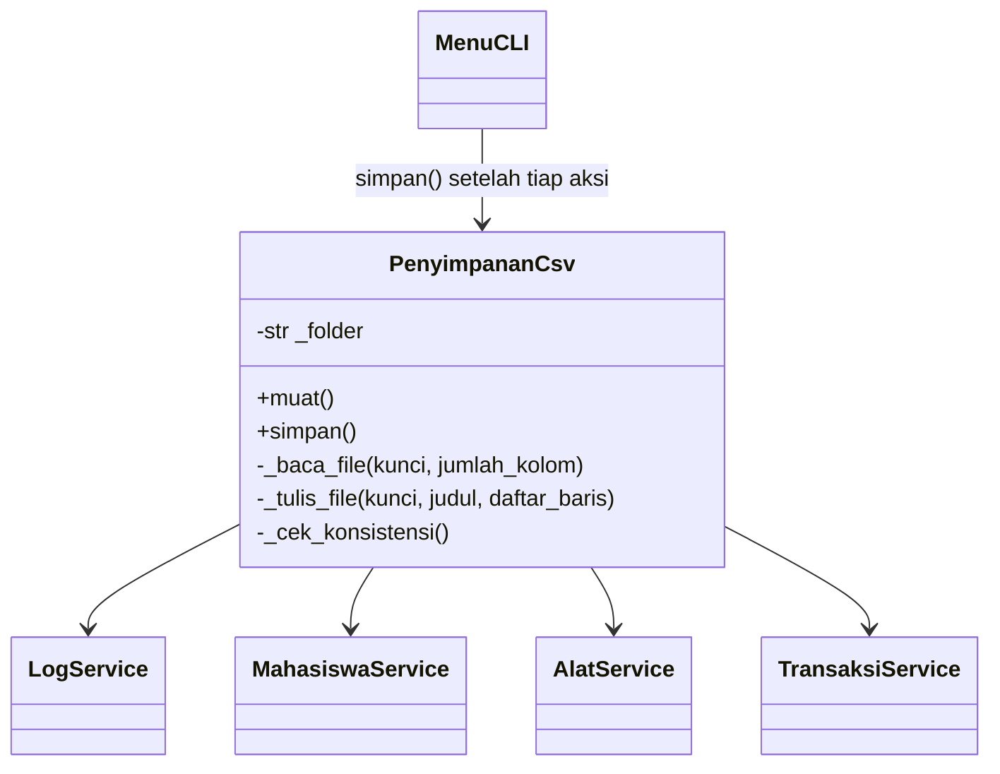

# Penyimpanan Permanen ke File CSV (Proyek 2)

Data disimpan ke file `.csv` di folder `data/` (dibuat otomatis di sebelah `main.py`) dan dibaca kembali
saat program dibuka. Tidak ada database. Memakai modul bawaan Python `csv`, `os`, `datetime`.

## Alur kerja
```
Program dibuka  -> PenyimpananCsv.muat()   : baca semua file .csv -> isi service (mahasiswa, alat, transaksi, log)
Setiap aksi menu berhasil -> PenyimpananCsv.simpan() : tulis semua file CSV
Menu 0 (keluar) -> simpan sekali lagi
```

## Daftar file
| File | Kolom (baris pertama = judul kolom) |
|---|---|
| `data/mahasiswa.csv` | `nim,nama,no_hp` |
| `data/alat.csv` | `kode,nama,kategori,kondisi,status` |
| `data/kategori.csv` | `kategori` |
| `data/transaksi.csv` | `id,nim,tanggal_pinjam,batas_kembali,status` |
| `data/detail_transaksi.csv` | `id_transaksi,kode_alat,tanggal_kembali,kondisi_kembali,terlambat` |
| `data/log.csv` | `waktu,pesan` |

Contoh isi nyata ada di [`contoh_data/`](contoh_data/).

## Aturan format
- **Pemisah `,`** (koma), standar CSV. Dengan pemisah koma, file tampil sebagai tabel di GitHub dan di editor CSV.
  Pemisah diatur oleh konstanta `PEMISAH` di `services/penyimpanan_csv_service.py`, dan pemisah yang sama dipakai
  saat menulis maupun membaca. File lama berpemisah `;` tidak lagi terbaca: hapus folder `data/` lalu jalankan ulang.
  Bila file koma dibuka di Excel dengan pengaturan regional Indonesia dan semua isi masuk ke satu kolom, buka lewat
  *Data > From Text/CSV* lalu pilih *Delimiter: Comma*.
- Baris pertama berisi nama kolom (dilewati saat membaca; bila tidak ada, baris itu dianggap data).
- Tanggal berformat `YYYY-MM-DD`. Nilai kosong (belum dikembalikan) ditulis `-`. Kolom `terlambat`: `1` atau `0`.
- Karakter khusus (pemisah, tanda kutip, baris baru) ditangani otomatis oleh modul `csv` dengan tanda kutip.
  Nama seperti `Eka ; "Putri", S.T.` tetap aman.
- Disimpan sebagai UTF-8 dengan BOM agar Excel menampilkan huruf berakses dengan benar. File UTF-8 tanpa BOM,
  akhir baris Windows (CRLF), dan baris kosong juga tetap terbaca. File yang bukan UTF-8 (mis. hasil simpan Excel biasa)
  ditolak dengan pesan yang jelas.

## Perbedaan dengan versi .txt
| | `.txt` (pemisah `\|`) | `.csv` (pemisah `,`) |
|---|---|---|
| Dibuka di Excel/Sheets | Tidak rapi | Langsung berbentuk tabel |
| Karakter khusus | Aturan pengkodean buatan sendiri (`\p`, `\n`, `\h`) | Ditangani modul `csv` (tanda kutip standar) |
| Komentar `#` di file | Boleh | Tidak ada; baris pertama adalah judul kolom |
| Baris baru di dalam nama | Dikodekan `\n` | Boleh, dalam tanda kutip |
| Kode pembaca/penulis | Dibuat sendiri | Memakai library standar (lebih sedikit kode) |

## Hati-hati bila mengedit lewat Excel
Excel mengubah isi sel secara otomatis ketika file disimpan ulang:
- **Nomor HP** yang diawali `0` menjadi angka tanpa nol di depan (`081234...` menjadi `81234...`).
- **Tanggal** `2026-11-06` bisa berubah menjadi format lokal seperti `06/11/2026`; program menolaknya dengan pesan
  "Tanggal harus berformat YYYY-MM-DD" beserta nama file dan nomor barisnya.

Karena itu: **buka dengan Excel untuk melihat boleh, tetapi untuk mengubah data sebaiknya lewat program ini** atau editor teks
(VS Code, Notepad). Bila harus memakai Excel, ubah dulu format kolom menjadi **Text**.

## Yang sengaja TIDAK disimpan
`Mahasiswa.transaksi_aktif` dan `Alat.transaksi_aktif` dihitung ulang dari transaksi saat file dimuat, sehingga tidak
mungkin bertentangan dengan isi transaksi.

## Keamanan data
- **Penulisan sederhana:** setiap file ditulis langsung dengan `open(..., "w")` dan modul `csv`. Jika penulisan gagal
  (mis. file dikunci OneDrive atau disk penuh), `PenyimpananError` dilempar, menu menampilkan peringatan, data tetap aman
  di memori, dan penyimpanan dicoba lagi pada aksi berikutnya.
- **Pemeriksaan saat memuat:** jumlah kolom, ID/NIM/kode ganda, status dan kondisi tidak dikenal, format tanggal, transaksi
  tanpa alat, status alat yang tidak cocok dengan kondisinya, status transaksi yang tidak sesuai detail alat, tanggal dan
  kondisi kembali yang tidak berpasangan, alat yang belum kembali di dua transaksi aktif, serta status alat yang tidak sesuai
  dengan transaksi aktif. Bila ada yang salah, program menampilkan nama file dan nomor baris, lalu **berhenti** (kode keluar 1)
  supaya data lama tidak tertimpa data kosong.
- **Ctrl+C / Ctrl+Z di prompt:** data disimpan lalu program keluar tanpa traceback.

## Perubahan kode dari Proyek 1
| File | Perubahan |
|---|---|
| `services/penyimpanan_csv_service.py` | **Baru.** Class `PenyimpananCsv` dengan `muat()` dan `simpan()` |
| `models/exceptions.py` | Tambah `PenyimpananError` |
| `main.py` | Memuat data saat mulai, menangani file rusak, Ctrl+C/Ctrl+Z |
| `ui/menu.py` | Parameter `penyimpanan`; `_simpan()` setelah tiap aksi berhasil dan saat keluar |
| `services/*_service.py`, `log_service.py` | Method `muat(...)` untuk mengisi data dari file |
| `data_contoh.py` | Data contoh dimuat seluruhnya atau tidak sama sekali |
| `tests/test_penyimpanan.py` | **Baru.** 38 pengujian penyimpanan CSV |

Perbaikan bug pada kode Proyek 1 yang ikut dilakukan:
1. `Alat` belum punya `kirim_ke_pemeliharaan()` padahal dipanggil `AlatService` (menu 12 akan error).
2. Salah ketik `terlambar` menjadi `terlambat` di `DetailPinjam`.
3. Aturan 6 untuk alat dibuat ketat: alat yang sudah dikembalikan tetapi transaksinya masih aktif tidak boleh dihapus
   (`Alat.transaksi_aktif` kini berupa list).
4. Kategori baru tidak tersimpan bila penambahan alat gagal.
5. `tests/test_skenario.py` memakai konstanta dari `models` (mis. `Kondisi_Baik`), bukan teks `"baik"`.
6. Kutip bersarang di f-string `models/alat.py` diganti agar jalan di Python di bawah 3.12.
7. `edit()` pada `MahasiswaService` dan `AlatService` memvalidasi semua input dulu; edit yang gagal tidak mengubah data.
8. Input angka unicode aneh (mis. `²`) di menu tidak lagi membuat program crash.
9. Kegagalan menyimpan (mis. file dikunci OneDrive) ditangani: menu menampilkan peringatan dan data tetap aman di memori.

## Class untuk UML final


## Keterbatasan
- Seluruh file ditulis ulang pada setiap aksi. Cukup untuk ribuan data; untuk data jauh lebih besar perlu
  penulisan bertahap atau database.
- Penulisan enam file bukan satu kesatuan. Bila program atau komputer berhenti tepat di tengah penulisan, sebagian file bisa
  tidak sinkron. Pemeriksaan konsistensi saat memuat akan mendeteksinya dan program berhenti dengan pesan yang jelas; pulihkan
  dari salinan (mis. git) atau hapus folder `data/` untuk mulai dari kosong.
- Hanya satu program yang boleh membuka folder `data/` pada saat yang sama.
- Repo di folder OneDrive dapat sesekali mengunci file; program menampilkan peringatan dan data tetap aman di memori.
